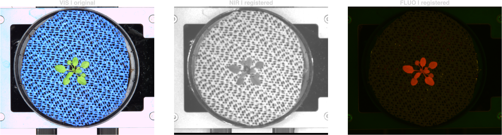
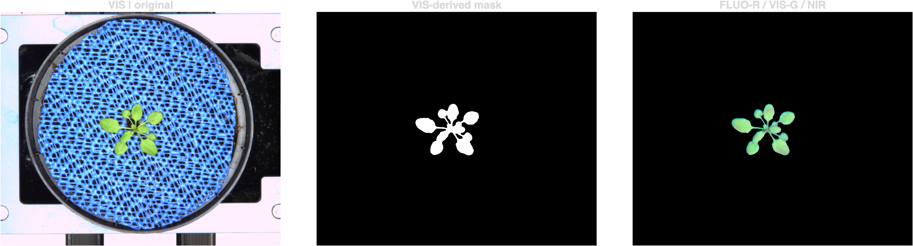
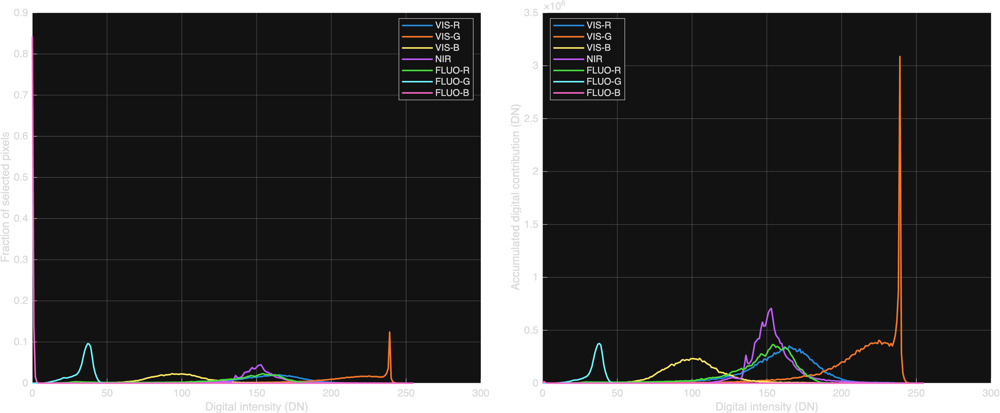

# PlantState4D

### From fluorescent signals to plant architecture

*Multiscale observation of Arabidopsis structure and development through 3D microscopy, quantitative imaging and multispectral phenotyping.*

**Work in progress** · MATLAB · Python · 2026

---

**Observation → Reconstruction → Quantitative characterization → Biological interpretation**

Fluorescence microscopy and multispectral imaging provide complementary views of plant organization, from cellular structures and developing tissues to whole-plant morphology.

The visualizations emphasize what is experimentally observed, how image-derived representations are constructed, and which biological questions they can support.

## 01 · Fluorescent signals and cellular organization

### Floral meristem · Membrane and auxin-response reporters

***Arabidopsis thaliana*** · Confocal fluorescence microscopy · 3D volumes

Two fluorescent reporters provide distinct biological observables.

**PM · `pUBQ10::acyl:TDT`** — membrane-associated fluorescence for observing cellular and tissue organization.

**DR5 · `DR5v2::n3eGFP`** — nuclear reporter of auxin-responsive transcriptional activity.

### Membrane-associated fluorescence

**Three observations · T1–T3**

3D renderings reveal the spatial organization of the imaged floral tissues.

<table>
<tr>
<td align="center"><b>T1</b> </td>
<td align="center"><b>T2</b> </td>
<td align="center"><b>T3</b> </td>
</tr>
</table>

### Complementary fluorescence signals

**T1 · PM + DR5**

<strong>PM</strong> · Membrane-associated fluorescence &nbsp; | &nbsp;
<strong>DR5</strong> · Auxin-response reporter

*Exploratory dual-channel visualization. Spatial registration remains provisional; apparent signal proximity does not establish colocalization. DR5 does not directly measure auxin concentration.*

---

## 02 · Cellular architecture and developing organs

### Ovule development

***Arabidopsis thaliana*** · Volumetric fluorescence microscopy · Seven annotated developmental stages

3D observations illustrate the architecture of developing ovules, including tissue boundaries and changing morphological organization.

### Three-dimensional observations

<table>
<tr>
<td align="center"><b>Stage 2-IV</b> </td>
<td align="center"><b>Stage 2-V</b> </td>
<td align="center"><b>Stage 3-I</b> </td>
<td align="center"><b>Stage 3-II</b> </td>
</tr>
<tr>
<td align="center"><b>Stage 3-III</b> </td>
<td align="center"><b>Stage 3-IV</b> </td>
<td align="center"><b>Stage 3-V</b> </td>
<td></td>
</tr>
</table>

*Developmental labels refer to the original morphological stage annotations. The animations show changes in viewpoint, not elapsed biological time.*

### Root tissue architecture

**3D fluorescence imaging · Spatial tissue organization**

A selected root volume illustrates cellular and tissue-level architecture in three dimensions.

*The animation rotates a selected volume; it does not represent a time-lapse.*

---

## 03 · Leaf morphology and tissue geometry

### Leaf epidermis · PM-YFP fluorescence

***Arabidopsis thaliana*** · 3D confocal microscopy · Three representative volumes

Membrane-associated fluorescence reveals aspects of tissue geometry and cellular organization.

The selected volumes illustrate differences in apparent leaf size and morphology, providing a starting point for quantitative characterization of cellular geometry and organ shape.

### Three-dimensional observations

<strong>Small leaf</strong>

<strong>Medium leaf</strong>

<strong>Large leaf</strong>

*The size labels describe representative samples, not a validated longitudinal growth sequence.*

---

## 04 · Whole-plant phenotyping and multispectral imaging

### Arabidopsis · RGB(VIS), NIR and FLUO

**IPK Gatersleben** · LemnaTec phenotyping platform · Top-view acquisition

Three complementary imaging modalities provide distinct optical observations of plant structure and digital signal responses.

**RGB(VIS)** · Visible imaging with red, green and blue channels.

**NIR** · Near-infrared imaging.

**FLUO** · Fluorescence imaging.

### Multispectral acquisition

Representative observations demonstrate the complementary information available from the three imaging modalities.

### Image registration, segmentation and fusion

**FLUO → Red · VIS → Green · NIR → Blue**

Geometric registration and plant segmentation support a common visual representation of the processed multimodal observations.

### Digital signal distribution

**VIS-R/G/B · NIR · FLUO-R/G/B**

Digital intensity distributions illustrate the responses of the seven channels used for exploratory characterization.

### Early rosette observations · 12–28 DAS

**Eight acquisitions · One plant · Three imaging modalities**

Repeated top-view observations of plant `1135FA1125` illustrate changes in projected morphology over time.

The labels indicate **days after sowing (DAS)**, recovered directly from the original experimental metadata.

*The fused colors are a visualization convention, not physical spectral colors. Digital intensities are not calibrated radiance; projected morphology does not directly measure biomass. Phenological classification of the selected images remains subject to visual verification.*

---

## From images to quantitative plant biology

**Geometry · Fluorescent signaling · Morphogenesis · Temporal observation**

Across cellular, tissue, organ and whole-plant scales, these datasets illustrate complementary experimental observables.

Their quantitative potential lies in connecting image-derived measurements with explicit biological questions: changes in cell and tissue geometry, spatial organization, organ morphology and plant development.

Understanding relationships with mechanical stress, material properties or biochemical regulation requires additional measurements, modeling and experimental validation.

The four demonstrations originate from independent datasets and do not constitute a single continuous multiscale experiment.

**[Data provenance and acquisition notes](DATA_SOURCES.md)**

---

*Work in progress · MATLAB · Python · 2026*
