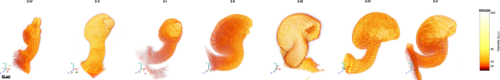
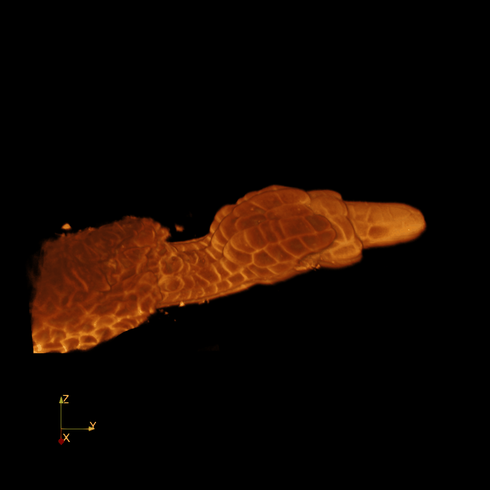
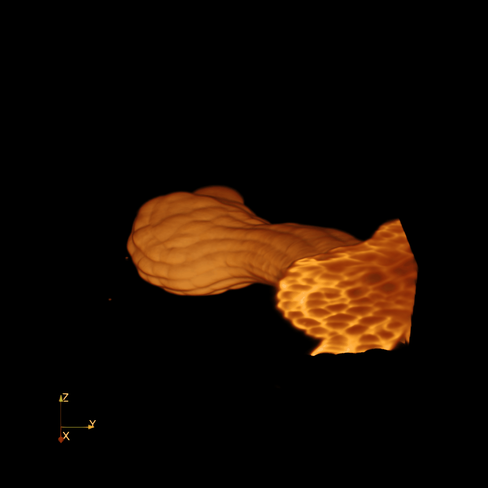
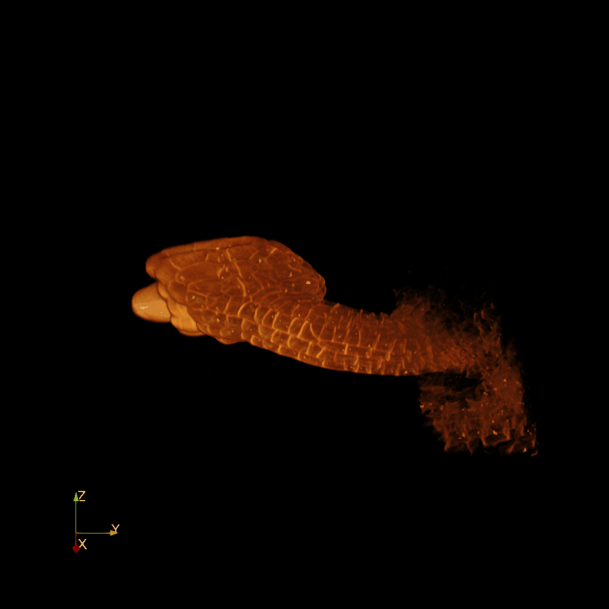
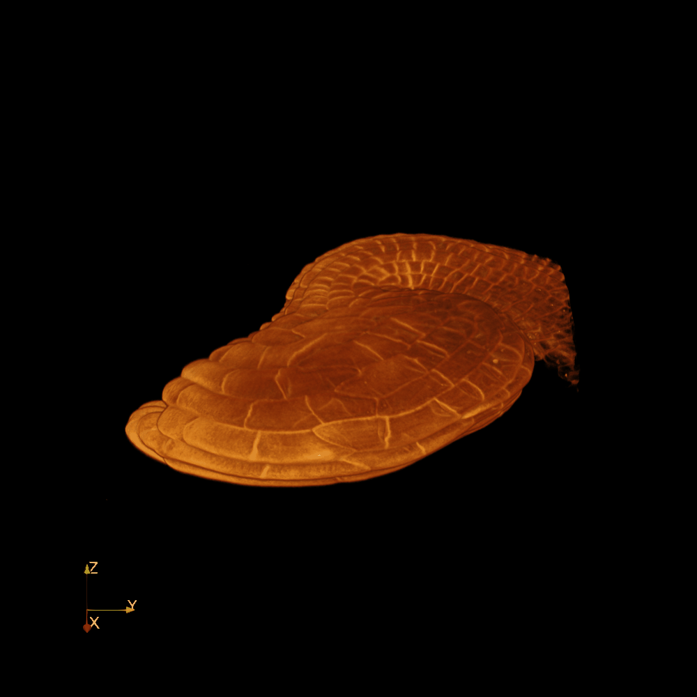
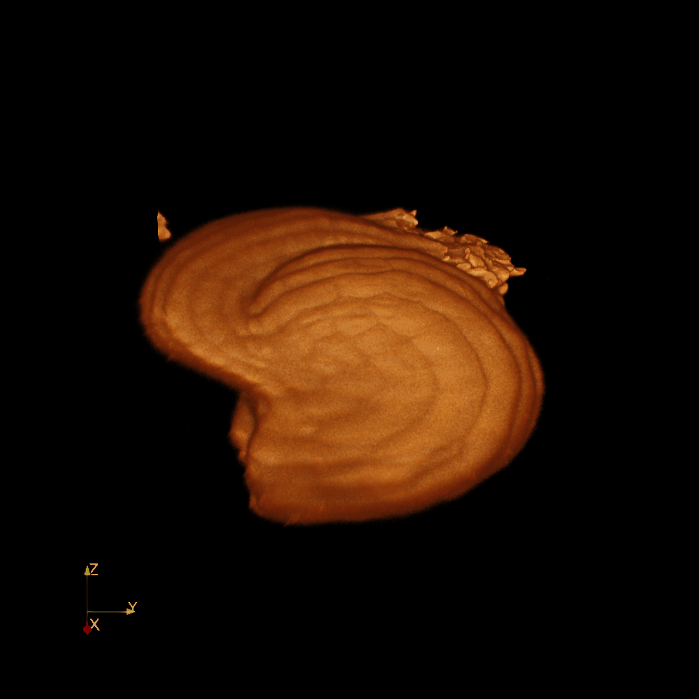
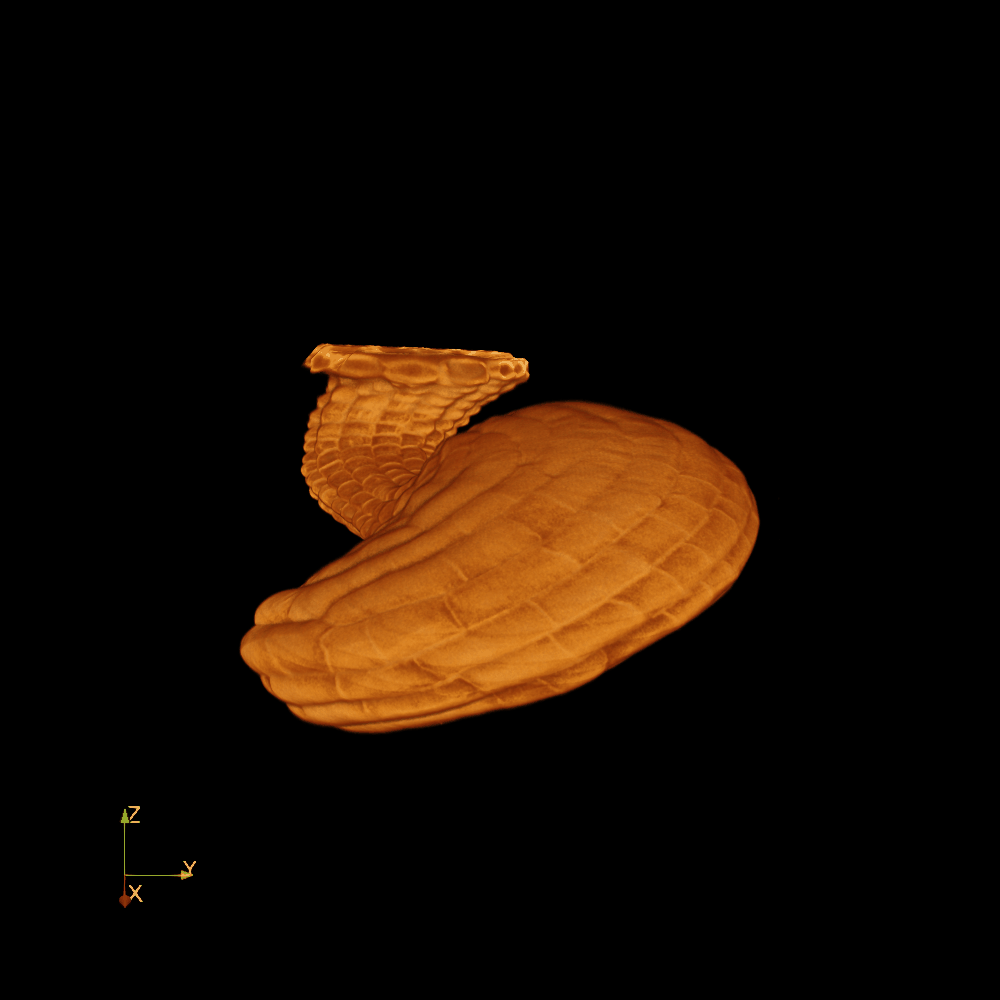
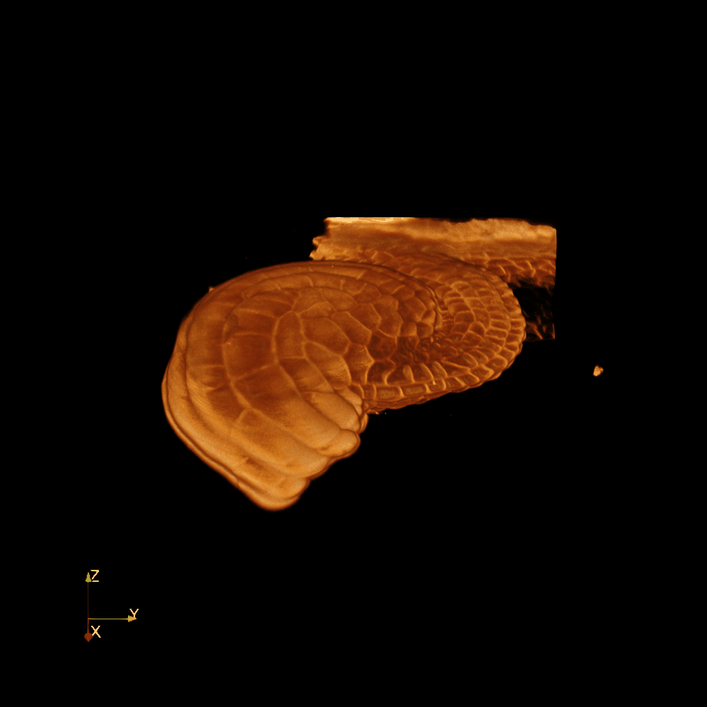

# PlantState4D

### 3D Microscopy · Quantitative Imaging · Plant Morphology

*Exploring plant structure and development through scientific imaging.*

**Work in progress** · MATLAB · ParaView · Python · 2026

---

## Ovule development

**Seven developmental stages | 3D fluorescence microscopy**

Volumetric visualization of tissue architecture and cellular organization.

### 3D rotations

<table>
  <tr>
    <td align="center"><b>Stage 2-IV</b> </td>
    <td align="center"><b>Stage 2-V</b> </td>
    <td align="center"><b>Stage 3-I</b> </td>
    <td align="center"><b>Stage 3-II</b> </td>
  </tr>
  <tr>
    <td align="center"><b>Stage 3-III</b> </td>
    <td align="center"><b>Stage 3-IV</b> </td>
    <td align="center"><b>Stage 3-V</b> </td>
    <td></td>
  </tr>
</table>

---

## Root architecture

**3D fluorescence microscopy**

A representative root volume rendered as a rotating 3D reconstruction.

  

---

### Technical focus

**Volumetric microscopy · Image processing · 3D rendering · fluorescence visualization · cellular morphology**

*Additional plant structures and multispectral imaging demonstrations are currently in development.*
